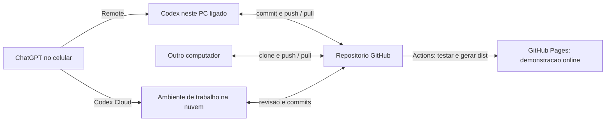

# GitHub, hospedagem e comandos pelo celular

Preparação em 03/11/2026. Os passos de autenticação e pareamento devem ser feitos pelo titular da conta. Não envie senhas, tokens, códigos de login ou QR de pareamento em conversas.

## 1. O papel de cada parte

Código sincronizado no GitHub e controle remoto são recursos diferentes. GitHub guarda arquivos e histórico; Remote permite comandar uma máquina conectada. Codex Cloud roda no ambiente da nuvem e pode trabalhar mesmo com o PC desligado. Nenhum dos dois torna esta conversa comum um controle remoto sem selecionar/parear o ambiente adequado.

## 2. Conectar o GitHub

Instalar a integração GitHub no ChatGPT/Codex e autorizar a conta no fluxo oficial. Preferir liberar apenas os repositórios usados. Confirmar a conta antes de criar qualquer repositório. Não é necessário pagar hospedagem para a demonstração estática se o Pages gratuito e a visibilidade pública forem apropriados.

Não existe repositório criado nesta pasta de preparação nem upload feito por estes arquivos. A pasta original do Sites foi preservada; esta é a cópia preparada para o GitHub, com as melhorias mais recentes da conversa.

## 3. Publicar a demonstração

Escolher primeiro a visibilidade do código. Pages em GitHub Free exige repositório público; planos como Pro/Team/Enterprise admitem outros casos. Não tornar público um repositório existente por conta própria. Com o repositório definido, enviar estes arquivos, habilitar Settings → Pages → Source: GitHub Actions e iniciar o workflow. O link final deve ser copiado da execução bem-sucedida, não presumido por um exemplo de URL.

O workflow publica apenas dist/. O servidor Python e SQLite não executam no Pages. O site de demonstração não tem autenticação própria; quem puder acessar o link publicado verá a demonstração, de acordo com a configuração do Pages e da conta.

## 4. Continuar em qualquer computador

1. Instalar Git e Node.js LTS compatível.
2. Clonar o repositório pela URL real.
3. Abrir a pasta no Codex.
4. Criar uma branch para o trabalho, executar os testes e revisar as mudanças.
5. Fazer commit e push; atualizar ou revisar essa mudança no outro computador.

As conversas do ChatGPT não são substituto para os commits do código. AGENTS.md guarda o contexto técnico para o Codex quando o projeto for aberto em outro ambiente.

## 5. Enviar comandos do celular para este PC — Remote

Conforme a documentação oficial: no aplicativo de desktop, abrir Settings → Connections → Control this Mac or PC → Set up/Add. Em português, procurar Configurações → Conexões → Controlar este Mac ou PC. Escanear o QR com o próprio celular, selecionar a máquina e usar a mesma conta e workspace.

No celular, abrir Remote/Codex, selecionar o computador pareado e a pasta do projeto. Retomar uma tarefa ou iniciar uma no projeto correto. O PC precisa ficar ligado, acordado, online e conectado. Se ele estiver suspenso/desligado ou sem rede, o trabalho local não roda. A documentação não garante que as opções estejam habilitadas em toda conta/versão; confirmar na interface do usuário.

Teste sugerido após parear: “Abra o projeto da barbearia e apenas me diga quais arquivos existem, sem editar nada.” Conferir aqui que a tarefa apareceu no computador selecionado. Depois enviar uma mudança pequena e verificar o resultado. Nenhum pareamento foi ativado nesta preparação.

## 6. Trabalhar com o PC desligado — Codex Cloud

No desktop ou web: Work in → Cloud → Select environment → Create environment. Selecionar o repositório GitHub e configurar o projeto. Aqui os comandos são npm test e npm run build, sem dependências obrigatórias do site. Rever o resultado e publicar o ambiente. No celular, abrir Codex e selecionar esse ambiente.

Cada tarefa cloud tem seu espaço de trabalho. Revisar o resultado e fazer commit/PR; depois atualizar o código local. O serviço cloud não edita automaticamente uma pasta deste PC desligado.

## 7. Estado desta entrega

Pronto localmente: código da demonstração, fluxo de conversa, teste/build, workflow Pages e instruções. Pendentes: conexão GitHub, escolha de conta/repositório/visibilidade, upload, execução real do Actions, URL pública confirmada e pareamento do celular. Não houve compra, mudança na política de energia do Windows ou liberação de acesso remoto.

## Fontes oficiais

- https://developers.openai.com/training/walkthroughs/working-on-your-phone
- https://developers.openai.com/blog/mastering-codex-remote-for-engineering
- https://learn.chatgpt.com/docs/cloud
- https://docs.github.com/en/pages/getting-started-with-github-pages/what-is-github-pages
- https://docs.github.com/en/pages/getting-started-with-github-pages/using-custom-workflows-with-github-pages
